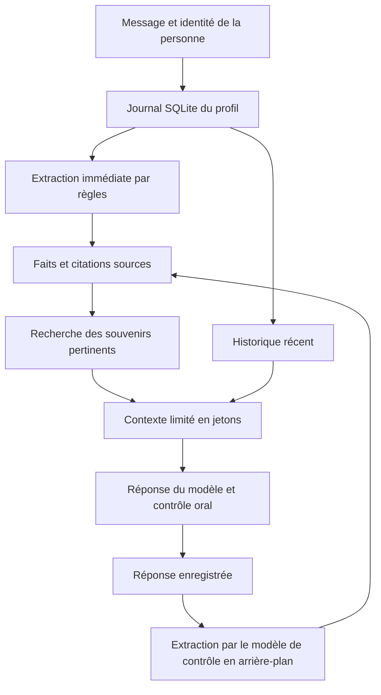

# Mémoire d'Alice V5 — fonctionnement retrouvé

Documentation préparée le 3 novembre 2026 à partir de l'installation originale.
Les fichiers publiés expliquent le mécanisme ; **aucun souvenir, compte réel,
message privé ou fichier de base de données n'est publié**.

## Quelle version est décrite ?

Le nom V5 désigne aussi des versions de modèle/personnalité dans les archives,
notamment `Alice-v5-reliable`. Le système de mémoire est un composant séparé
des poids de ce modèle. Les archives de conversations V5 mentionnent le vrai
`BrainEngine` avec des mémoires temporaires.

Cette page reconstitue le fonctionnement de la mémoire de cette lignée à partir
du code de l'installation originale encore présent et de sa documentation.
Les trois fichiers sont **l'état du code retrouvé le 3 novembre 2026**, qui a
continué à évoluer : ce n'est pas un instantané historique certifié d'une release
V5 précise. Les réglages indiqués sont ceux du code/configuration consultés,
pas une garantie de réglages identiques pour tous les anciens essais V5.

Ce mécanisme est distinct de la mémoire épisodique et des nouveaux lecteurs du
[laboratoire actuel](../../docs/etat/actuel.md).

## L'idée générale

Alice garde un journal des échanges et en extrait certains faits durables.
Quand elle répond, elle recherche des faits pertinents et les ajoute au contexte
fourni au modèle, avec un historique récent. La conversation ne réentraîne pas
automatiquement les poids du modèle. Un fait enregistré peut donc exister sur
disque sans être sélectionné ou correctement utilisé dans une réponse.

Ce schéma décrit le parcours ordinaire persistant. Le code comporte aussi un
parcours éphémère qui répond sans ouvrir de mémoire utilisateur ; tous les
messages de plateforme ne doivent donc pas être assimilés à ce schéma.

## 1. Une base locale par personne

Le stockage par défaut est relatif à la racine du projet :
`data/users/<identifiant>/memory.sqlite3`. La clé est l'identifiant utilisateur
fourni au magasin, pas simplement un pseudo affiché. Le magasin ne réalise pas
l'authentification : la résolution correcte du compte appartient au programme
appelant. Une base séparée n'est pas une frontière de sécurité du système Windows.

| Table | Contenu |
| --- | --- |
| `events` | Messages et réponses, rôle, canal, date, identifiant de requête et empreinte du contenu |
| `memories` | Faits extraits, type, confiance, clé éventuelle, dates et état actif/remplacé/rejeté |
| `evidence` | Lien entre chaque fait, un événement source et la citation utilisée |
| `mood` | État d'humeur persistant, distinct des faits |
| `metadata` | Version du schéma |

SQLite utilise WAL, `synchronous=FULL`, les clés étrangères et des transactions
`BEGIN IMMEDIATE` avec validation ou annulation. Un verrou protège chaque instance
du magasin. Il ne coordonne pas à lui seul plusieurs processus distincts.

## 2. Comment un échange devient un souvenir

L'extraction immédiate reconnaît des formulations comme le nom, le lieu de vie,
des préférences, certains attributs et « retiens que… ». Elle écarte certains
contextes de question, citation ou hypothèse. Ces règles ne comprennent pas
toutes les formulations naturelles.

Après la réponse, une seconde extraction peut être envoyée au modèle de contrôle
par une file de travail à un seul thread. Elle demande des faits durables en
JSON : texte du fait, type, citation source et confiance. Le code refuse les
sorties mal formées et ignore les propositions de confiance inférieure à 0,80.
Cette confiance est une valeur proposée par le modèle, pas une probabilité
de vérité calibrée.

La citation doit se retrouver dans le message source **après normalisation**
(casse, accents, ponctuation). Ce contrôle ne garantit donc ni une copie exacte
caractère par caractère, ni que le fait reformulé respecte le sens de la citation.
L'extraction en arrière-plan enrichit surtout les tours suivants : elle ne peut
pas modifier la réponse déjà livrée. L'arrêt propre attend la file, mais ce
parcours ne définit pas de file persistante de reprise après un arrêt brutal.

## 3. Doublons et corrections

Un même identifiant de requête rejoué avec le même message retrouve l'événement
existant. Réutiliser cet identifiant avec un autre contenu provoque une erreur.
Une preuve déjà enregistrée n'augmente pas artificiellement le compteur de vues.

Quand deux faits portent la même clé et des valeurs différentes, l'ancien passe
à `superseded` et le nouveau devient actif. Exemple fictif : deux déclarations
successives de lieu de vie sous la clé `identity.location`.

**Ce remplacement n'efface pas le journal ni l'ancienne preuve.** Il ne sait pas,
à lui seul, distinguer un déménagement réel d'une rectification d'erreur. Les
faits proposés par l'extracteur de modèle n'ont pas de clé dans ce parcours :
la résolution générale des contradictions n'est pas assurée.

## 4. Comment Alice retrouve un souvenir

La recherche de ce magasin est **lexicale**, avec normalisation, mots ignorés
et quelques équivalences comme « adore » / « aime ». Le code ne contient pas
ici de recherche vectorielle, de FTS5 ou de modèle d'embeddings.

Il examine jusqu'à 2 000 souvenirs actifs, classés d'abord par mise à jour.
Pour une question précise, le score combine couverture des mots de la question,
nombre de mots communs, confiance et récence. La limite par défaut est de
12 résultats. Un fait ancien hors de ces 2 000 candidats ne sera pas retrouvé
par cette recherche, même s'il est encore conservé dans la base.

Pour un bilan général (« que sais-tu de moi ? »), le code privilégie les faits
actifs les plus récemment mis à jour. Le module `query.py` permet aussi au modèle
de contrôle de classer les formulations moins littérales en demande de profil.
En cas de résultat invalide, le chemin lexical reste disponible.

La configuration consultée demande 24 événements récents et 12 souvenirs.
Le constructeur de contexte applique ensuite un budget de jetons : il peut
retenir moins de souvenirs. Le nombre `memories_used` indique les éléments
inclus dans le contexte, pas ceux que le modèle a effectivement compris.

## 5. Pourquoi la direction actuelle a changé

Le stockage, le rappel et la compréhension sont trois problèmes différents.
Cette architecture peut conserver correctement une citation tout en tirant
un fait incorrect, manquer un rappel faute de mots communs ou conserver deux
affirmations contradictoires sans clé commune.

Le laboratoire travaille maintenant sur une lecture plus fidèle des échanges
entiers : faits, corrections, chronologie, incertitudes et intentions historiques.
Il possède d'autres mécanismes de recherche et d'oubli ; ils ne doivent pas être
attribués rétroactivement au magasin décrit ici. Ses nouveaux lecteurs restent
non qualifiés, comme indiqué dans la [présentation actuelle](../../docs/etat/actuel.md).

## Code et sources consultables

- [store.py](extraits/store.py) : tables, transactions, preuves, corrections et rappel.
- [extractor.py](extraits/extractor.py) : extraction par règles et contrat du modèle.
- [query.py](extraits/query.py) : classification d'une demande générale de profil.
- [Provenance et contrôle de publication](PROVENANCE.md).

Ces modules sont publiés pour lecture. Leurs imports `alice.*`, le cerveau,
le résolveur de chemins, la configuration et les modèles ne sont pas tous inclus.
Ce n'est pas un programme autonome à lancer ni une migration de mémoire.
Le statut des droits reste celui indiqué dans le [README principal](../../README.md).
